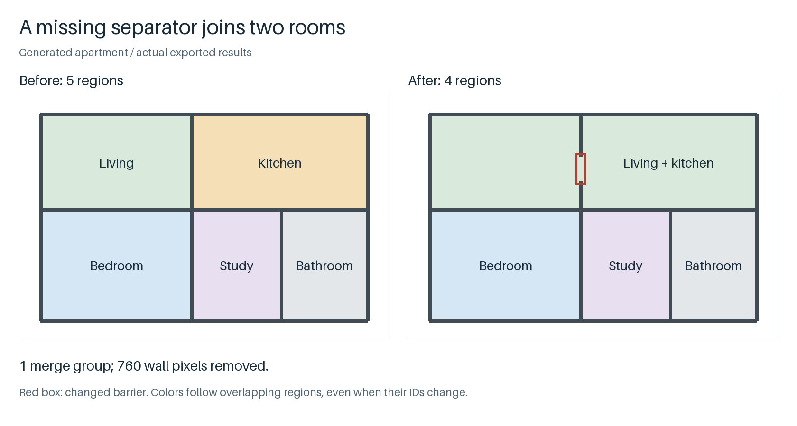

# PlanRegions

比较两版户型结果，找出合并、拆分或消失的房间。

[English](README.md) · [交互演示](https://crown-sports.github.io/planregions/) · [v0.4.0](https://github.com/crown-sports/planregions/releases/tag/v0.4.0)



生成示例：移除红框内的一段隔墙，客厅和厨房连在一起，区域数量从 **5 变成 4**。[运行这张示例](https://github.com/crown-sports/planportals/blob/main/docs/workflow.zh-CN.md)。

## 先跑起来

Python 3.10+。区域几何和前后比较都不需要模型。

```bash
python -m pip install "git+https://github.com/crown-sports/planregions.git@v0.4.0"
planregions demo --output runs/demo
```

这个较小的独立 demo 生成三个区域。打开 `runs/demo/regions.png` 看预览；精确实例编号在 `labels.npz`，像素面积、多边形和区域内点在 `regions.json`。

处理自己的墙体掩码：

```bash
planregions detect --walls /private/walls.png --output runs/regions
```

255 表示墙、0 表示背景；黑墙加 `--wall-value 0`。WallGraph 输出可加 `--wall-metadata /private/walls.json`，检查尺寸和坐标约定是否一致。

## 比较两版结果

两份整数标签图必须位于同一个原图像素网格：

```bash
planregions compare --before runs/before/labels.npz \
  --after runs/after/labels.npz --output runs/review/changes.json \
  --html-output runs/review/changes.html
```

在本地打开 `changes.html`，点击区域或变化组，同时查看前后图和受影响的像素数量。报告能指出合并、拆分、消失和背景变化，单纯换编号不会算成变化；报告不发网络请求。

加 `--fail-on merge disappeared` 后，遇到这些变化会先保存报告，再退出 **1**；输入不合法退出 **2**。多张图可用 `compare-batch` 生成逐图报告和汇总，见[比较说明](docs/comparison.zh-CN.md)。

## 这些区域代表什么

默认先排除与图像边缘连通的外部空间，再划分剩余非墙像素，保留柱子、庭院等孔洞。外墙漏一段，内部也可能被当成室外；这种图需要提供建筑范围或显式分隔线。分水岭可选，但可能过分割。

面积按标签像素计数，简化后的多边形面积可能不同；坐标是图像像素，不是经纬度。图中的房间名称来自提供的标注；没有语义输入时，房间类型保持未知。没有比例尺时，不输出平方米。

变化报告说明哪里变了，不能说明哪版更准。私有评估中，相同墙体条件下的 PQ 改善不显著，新完整流程仍有退步。[结果](docs/results.md) · [验证](docs/validation.md)。

## 继续看

[本地交互复核](docs/visual-review.zh-CN.md) · [几何与输入选项](docs/use-cases.zh-CN.md) · [实现说明](docs/product.md) · [方法](docs/methods.zh-CN.md) · [架构](docs/architecture.md)

[贡献](CONTRIBUTING.md) · [发布检查](docs/releasing.md) · [安全报告](SECURITY.md)

代码与生成图使用 MIT 许可，不分发真实图纸、标注或权重。[来源说明](NOTICE.md)。
